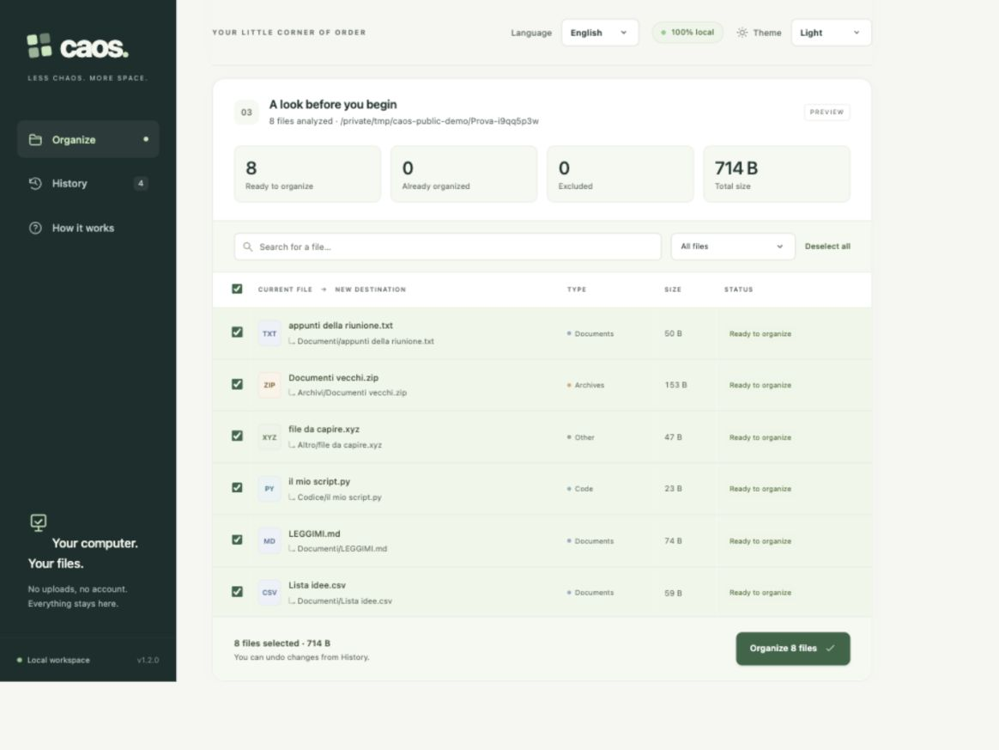
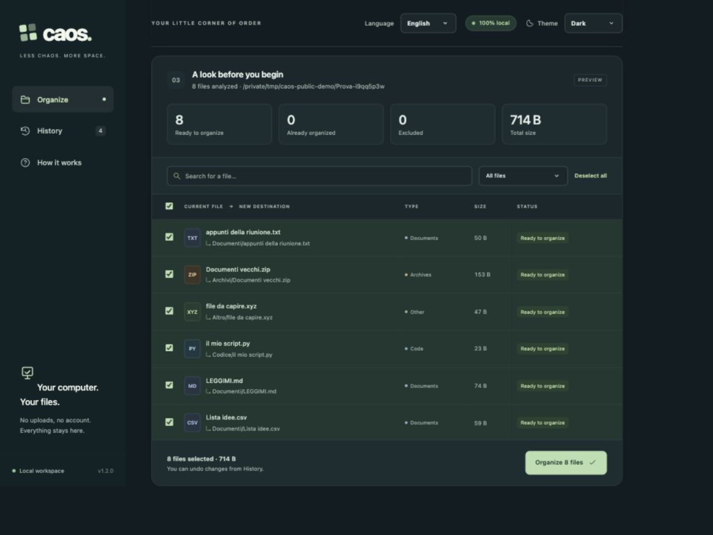

# Caos

**A local file organizer with a preview before every change and a history you can undo.**

Caos helps you organize photos, documents, and downloads from a browser interface. Group files into folders, clean up their names, or apply a numbered naming scheme. Review the exact changes and select which files to include before applying them.

The interface is available in **Italian and English**. The application runs on your computer using Python's standard library: no accounts, cloud uploads, API keys, package installation, or subscription required.



## Features

- **Preview first:** inspect source and destination paths, search the list, and select individual files.
- **Flexible organization:** group by file type, modification month, or both; rename without moving files if preferred.
- **Naming options:** retain original names, normalize names, or use a custom prefix and sequence number.
- **Persistent undo:** view operation details and restore original paths after restarting the application.
- **Collision handling:** assign an available suffix during preview and check again before moving files.
- **Folder browser:** navigate folders, enter a path, and use shortcuts for common locations.
- **Light, dark, and system themes:** choose an appearance and retain your preference in the browser.
- **Italian and English:** switch languages from the top bar without losing your current preview or selection. The browser remembers your choice.
- **Built-in demo:** experiment with disposable sample files before choosing your own folder.

<details>
<summary>View dark mode</summary>



</details>

## Requirements

- **Python 3.10 or later**.
- A modern browser.
- **macOS**, the primary development and validation platform.

A Linux backend is included, but Linux has not received the same end-to-end validation. Windows is not supported. File operations require a filesystem that supports the operating system's atomic rename-without-replacement primitive; unsupported filesystems produce an error.

## Quick start

Download this repository using **Code → Download ZIP**, extract it, and open a terminal in the extracted directory. Then run:

```sh
python3 server.py
```

Alternatively, clone the repository:

```sh
git clone https://github.com/Riccardo-RG/caos-file-organizer.git
cd caos-file-organizer
python3 server.py
```

On macOS, you can also double-click **Avvia Caos.command**, or launch it from the terminal:

```sh
./"Avvia Caos.command"
```

Caos opens your browser automatically. The default address is `http://127.0.0.1:8765`; if that port is occupied, the terminal displays the available port selected instead. The server listens only on the local loopback address.

Leave the terminal open while using Caos. Press **Ctrl+C** there to stop the application; closing the browser tab alone does not stop the server. Starting Caos again with the same history directory reopens the existing instance.

The interface starts in Italian. Choose **English** from the **Lingua** menu in the top bar to switch languages. Theme and language preferences are stored independently in your browser.

### Try the demo

Click **Try sample files** to create a fresh sample folder inside `esempi/`. Generate a preview, apply some changes, then open **History** and undo them. Each demo creates a separate folder.

### Organize a folder

1. Click **Choose folder** and select a folder, or enter its path directly.
2. Choose how to group and rename files. Optionally enable subfolders and filter file categories.
3. Click **Generate preview** and review the proposed paths. Deselect any files you want to leave alone.
4. Apply the selected changes and confirm the summary.
5. Open **History** to inspect an operation or select **Undo changes**.

Changing the folder or organization rules invalidates the preview. Generate a new preview before applying a different set of rules.

## How file handling works

Classification uses file extensions. Category folders use the Italian labels **Immagini**, **Documenti**, **Archivi**, **Audio**, **Video**, **Codice**, and **Altro** in both interface languages. Changing the language updates labels and messages without changing filenames or destinations. Month-based grouping uses the file's **last modification time**, not the photo's EXIF capture date.

The preview does not move or rename your files. Before applying changes, Caos checks file identity, metadata, content hashes, and destination availability. Moves use the operating system's exclusive rename operation, which refuses to replace an existing destination. An interrupted operation is recorded in the journal for recovery or review.

The following limits are intentional:

- Hidden files, symbolic links, application bundles, and photo libraries are excluded. Export photos to an ordinary folder to organize them.
- Temporary files and incomplete downloads are skipped.
- Recursive scans skip folders named after a category or matching `YYYY-MM`, to avoid processing previous output again. Select one of those folders directly to organize its contents.
- Scans do not cross into mounted filesystems inside the selected folder.
- A preview is limited to 100,000 files. Content verification reads file contents, so large collections can take time.

### Undo and history

History is stored in **`.caos-data/`**, next to the application by default. Keep this directory when upgrading or moving an existing installation. You can choose another location with `--data-dir`.

Undo checks that moved files are unchanged and their original paths are available. If another program has edited, replaced, moved, or deleted a file, Caos reports a conflict rather than overwriting those changes. Some interrupted operations may require manual review.

**History records movements; it is not a backup of file contents.** Keep your normal backups. Undo depends on both the saved history and the files remaining available.

## Command-line options

The command line starts and configures the browser application; file selection and organization happen in the interface.

```sh
python3 server.py --help
python3 server.py --no-browser
python3 server.py --port 9000
python3 server.py --port 0
python3 server.py --data-dir "$HOME/.local/share/caos"
```

| Option | Purpose |
| --- | --- |
| `--no-browser` | Start the server without opening a browser tab. |
| `--port PORT` | Choose a local port; `0` requests an available port. Default: `8765`. |
| `--data-dir PATH` | Choose the directory for previews, operation history, and the instance lock. |

On macOS, if access to Desktop, Documents, or Downloads is denied, allow the terminal application access under **System Settings → Privacy & Security → Files and Folders**, where available, or choose a folder it can already access. Caos does not require `sudo`.

## Development

Caos has no third-party runtime dependencies and no frontend build step.

| Path | Responsibility |
| --- | --- |
| `organizer.py` | Scanning, previews, naming rules, exclusive moves, persistent journals, and undo. |
| `server.py` | Local HTTP server, request validation, folder browsing, and sample files. |
| `web/` | HTML, CSS, and JavaScript interface with locally served assets. |
| `tests/` | Automated tests for file operations, HTTP behavior, startup, and packaging. |
| `build_release.py` | Builds a portable source ZIP without history or demo files. |
| `VERIFICATION.md` | Validation scope, results, and platform limitations. |

The server serializes file operations and permits one instance per history directory. State-changing requests use a session token and request-origin checks. The application is intended for local, single-user use.

### Run tests

From the repository root:

```sh
python3 -m unittest discover -s tests -v
```

Tests use temporary files and cover preview behavior, naming rules, partial selection, collisions, content preservation, persistent undo, interrupted operations, path validation, HTTP protections, folder browsing, startup, and release packaging. They do not organize your personal files.

### Build a release

```sh
python3 build_release.py
```

Version 1.2 produces `dist/Caos-1.2.zip`, containing the application, web assets, documentation, and tests. Generated releases, local history, and demo folders are excluded from version control. When updating an existing installation, retain its `.caos-data/` directory.
